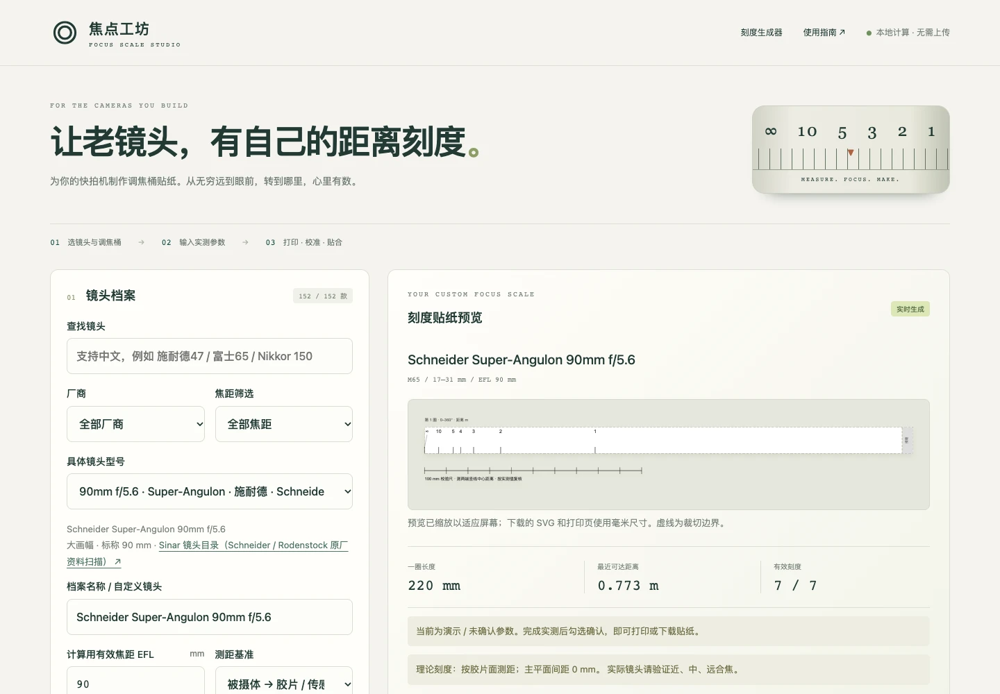
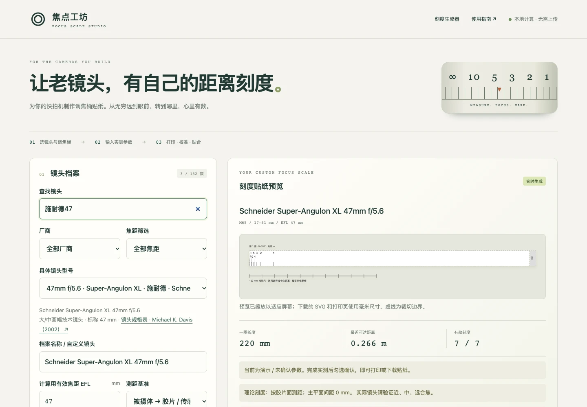
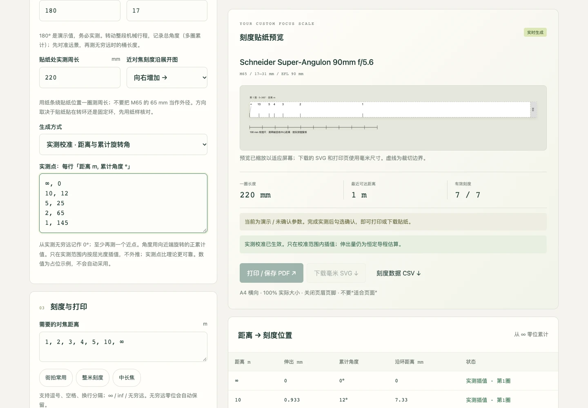
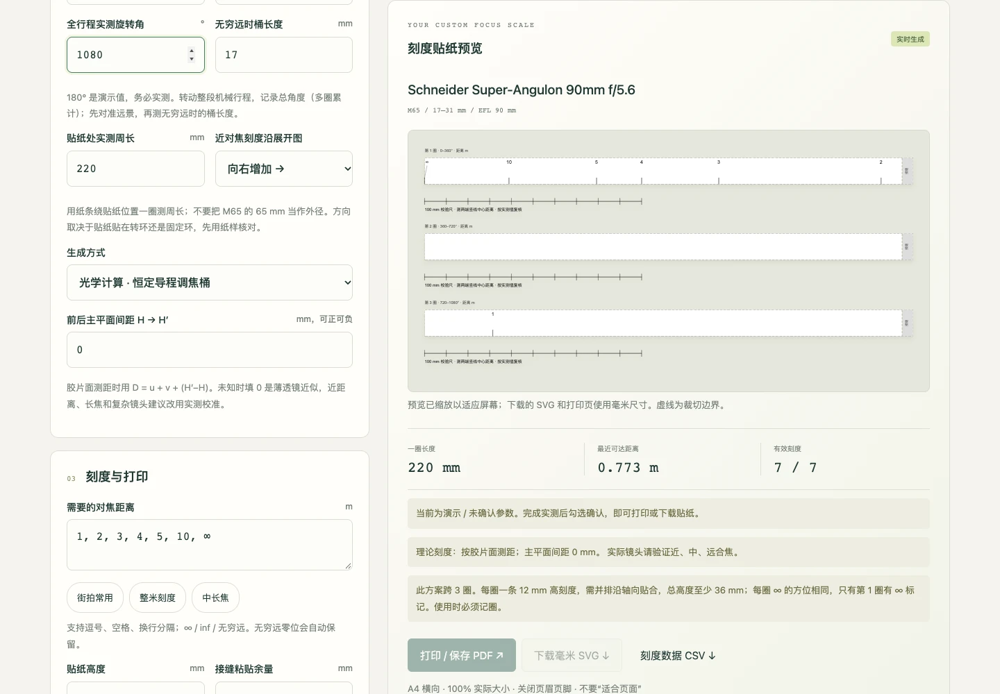
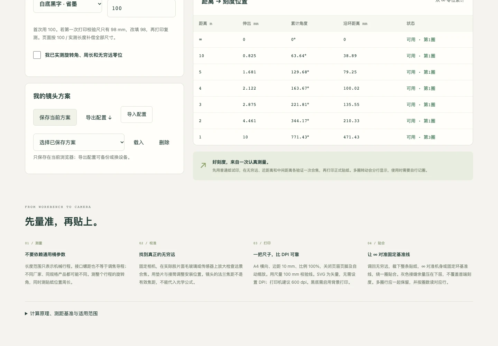
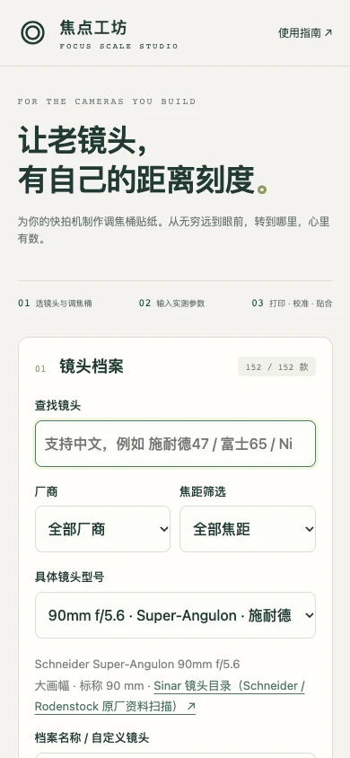
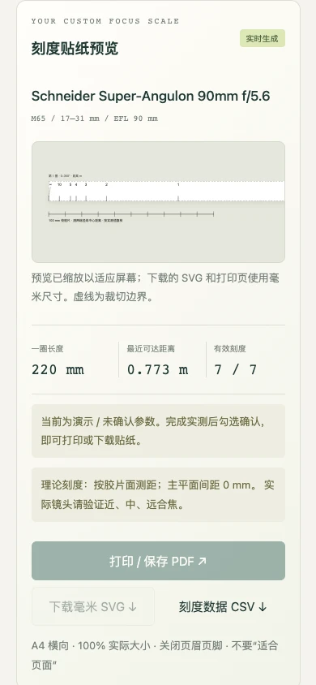

# 焦点工坊 / Focus Scale Studio

离线可用的调焦桶距离刻度贴纸工具，支持手机与桌面布局，无第三方依赖。

镜头库包含 152 款型号：施耐德 48、罗敦司得 40、尼康 24、富士 30、玛米亚 10。支持中文搜索（例如“施耐德47”），47 mm 普通 f/5.6、f/8 和 f/5.6 XL 分开列出。旧方案使用的镜头 ID 保持兼容。



[界面导览](#界面导览) · [使用流程](#使用) · [镜头目录](#支持的镜头) · [计算模型](#模型) · [验证](#验证)

## 界面导览

以下为真实浏览器截图，使用内置镜头及**演示参数**，未读取个人方案。示例校准点不是任何具体镜头或调焦桶的实测数据；界面的提醒和输出限制均保留。图片可点击查看大图。

### 镜头检索：先核对具体型号

**入口：** 镜头档案 → 查找镜头。中文、英文关键词可以与厂商、焦距筛选叠加；普通版、不同光圈和 XL 型号分开列出。选择型号后仍应按实际需要修正 EFL。



### 实测校准：输入距离与累计角度

**入口：** 调焦桶与实测 → 生成方式 → 实测校准。每行填写距离（米）及从无穷远开始累计的正旋转角（度），包含无穷远零位和至少一个近点。只在实测范围内插值，不向外推算。



<details>
<summary>多圈刻度与输出：保留圈数，检查可用距离</summary>

**入口：** 输入实际全行程角度 → 刻度与打印。超过一圈时分条显示，使用时需要记圈，并预留轴向粘贴空间。超出机械行程的距离会提示并排除；文字过密或尚未确认实测参数时，打印 / SVG 入口保持禁用。



CSV 用于核对刻度数值，JSON 用于备份方案。两种下载通路已用演示参数验证；这不代表贴纸已通过实物测量或打印机校准。

</details>

<details>
<summary>从测量到贴合：先量校验尺，再裁切安装</summary>

页面下方提供测量、无穷远校准、打印和贴合说明。先用实物检查合焦和角度，再按 100% 实际大小试打并测量校验尺，最后裁切；不要直接按截图或屏幕尺寸制作贴纸。



</details>

### 手机：分段填写，向下查看预览

手机采用单栏布局：先填写镜头和机械参数，再向下查看刻度、有效范围和输出按钮。输入与预览使用同一套模型，不上传参数。

<p align="center">
  
  
</p>

维护者可通过 [截图工具说明](docs/screenshots/README.md) 重新生成本文图片。截图工具是可选维护依赖，日常运行仍不需要 Node.js 或 npm。

## 使用

双击 `index.html` 即可使用。也可在此目录运行：

```sh
python3 -m http.server 8765 --bind 127.0.0.1
```

电脑访问 `http://localhost:8765`。需要同一局域网手机访问时，可将监听地址改为 `--bind 0.0.0.0`，再访问 `http://电脑局域网IP:8765`。静态文件也可直接放到普通网站服务器。

1. 选择厂商、焦距和具体镜头型号，或输入自定义镜头。预设只提供标称焦距，不能替代实测 EFL。
2. 输入调焦桶机械长度范围、整个行程的实测旋转角、无穷远时桶长度，以及贴纸处实测周长。初始角度和周长都是演示参数。
3. 选择测距基准。更精确的办法是用实际胶片面/传感器检查合焦，输入距离与累计旋转角校准点。
4. 输入距离列表，确认有效范围与文字间距。超出行程的距离不输出。
5. 完成实测确认后，打印或下载毫米 SVG。打印为 A4 横向、100% 实际大小，关闭缩放和页眉页脚；先量校验尺再裁切。
6. 配置存于当前浏览器，可导入/导出 JSON 备份。不同浏览器、不同来源地址的存储互不相通。直接打开文件时若浏览器限制本地存储，请使用本地服务器或导出配置。

## 支持的镜头

以下为当前内置的全部 152 款镜头，按厂商和系列列出。每个“焦距 + 最大光圈”组合对应一个独立型号；普通版、XL、HM、APO、CM-W 等系列分别保留。

预设提供型号身份和标称焦距，可在选择后修正有效焦距，也可填写未收录的自定义镜头（有效焦距范围 1–2000 mm）。镜头条目不表示已验证与某款调焦桶机械兼容，也不保证覆盖指定画幅。

### 施耐德 Schneider（48 款）

| 镜头系列                  | 支持的具体规格（焦距 / 最大光圈）                                                                                                          |
| ------------------------- | ------------------------------------------------------------------------------------------------------------------------------------------ |
| Super-Angulon XL          | 38 mm f/5.6；47 mm f/5.6；58 mm f/5.6；72 mm f/5.6；90 mm f/5.6                                                                            |
| Super-Angulon             | 47 mm f/5.6；47 mm f/8；65 mm f/5.6；75 mm f/5.6；90 mm f/5.6；90 mm f/8；120 mm f/8；165 mm f/8；210 mm f/8                               |
| Super-Symmar XL           | 80 mm f/4.5；110 mm f/5.6；150 mm f/5.6；210 mm f/5.6                                                                                      |
| Apo-Symmar                | 100 mm f/5.6；120 mm f/5.6；135 mm f/5.6；150 mm f/5.6；180 mm f/5.6；210 mm f/5.6；240 mm f/5.6；300 mm f/5.6；360 mm f/6.8；480 mm f/8.4 |
| Symmar-S                  | 100 mm f/5.6；135 mm f/5.6；150 mm f/5.6；180 mm f/5.6；210 mm f/5.6                                                                       |
| Super-Symmar HM           | 120 mm f/5.6；150 mm f/5.6；210 mm f/5.6                                                                                                   |
| G-Claron                  | 150 mm f/9；210 mm f/9；240 mm f/9；270 mm f/9；305 mm f/9；355 mm f/9                                                                     |
| Xenar                     | 150 mm f/5.6；210 mm f/6.1                                                                                                                 |
| Tele-Arton                | 250 mm f/5.6                                                                                                                               |
| Apo-Tele-Xenar HM         | 400 mm f/5.6                                                                                                                               |
| Apo-Tele-Xenar HM Compact | 400 mm f/5.6                                                                                                                               |
| APO-Tele Xenar HM         | 800 mm f/12                                                                                                                                |

### 罗敦司得 Rodenstock（40 款）

| 镜头系列      | 支持的具体规格（焦距 / 最大光圈）                                                                                            |
| ------------- | ---------------------------------------------------------------------------------------------------------------------------- |
| Apo-Grandagon | 35 mm f/4.5；45 mm f/4.5；55 mm f/4.5                                                                                        |
| Grandagon-N   | 65 mm f/4.5；75 mm f/4.5；75 mm f/6.8；90 mm f/4.5；90 mm f/6.8；115 mm f/6.8；155 mm f/6.8；200 mm f/6.8                    |
| Apo-Sironar-N | 100 mm f/5.6；135 mm f/5.6；150 mm f/5.6；180 mm f/5.6；210 mm f/5.6；240 mm f/5.6；300 mm f/5.6；360 mm f/6.8；480 mm f/8.4 |
| Sironar-N     | 100 mm f/5.6；135 mm f/5.6；150 mm f/5.6；180 mm f/5.6；210 mm f/5.6                                                         |
| Apo-Sironar-S | 135 mm f/5.6；150 mm f/5.6；180 mm f/5.6；210 mm f/5.6；240 mm f/5.6；300 mm f/5.6；360 mm f/6.8                             |
| Apo-Ronar     | 150 mm f/9；240 mm f/9；300 mm f/9；360 mm f/9；480 mm f/9                                                                   |
| Apo-Sironar-W | 150 mm f/5.6；210 mm f/5.6；300 mm f/5.6                                                                                     |

### 尼康 Nikon（24 款）

| 镜头系列    | 支持的具体规格（焦距 / 最大光圈）                                                                              |
| ----------- | -------------------------------------------------------------------------------------------------------------- |
| Nikkor-SW   | 65 mm f/4；75 mm f/4.5；90 mm f/4.5；90 mm f/8；120 mm f/8；150 mm f/8                                         |
| Nikkor-W    | 105 mm f/5.6；135 mm f/5.6；150 mm f/5.6；180 mm f/5.6；210 mm f/5.6；240 mm f/5.6；300 mm f/5.6；360 mm f/6.5 |
| Nikkor-M    | 200 mm f/8；300 mm f/9；450 mm f/9                                                                             |
| Nikkor-T ED | 270 mm f/6.3；360 mm f/8；500 mm f/11；600 mm f/9；720 mm f/16；800 mm f/12；1200 mm f/18                      |

### 富士 Fujifilm（30 款）

| 镜头系列              | 支持的具体规格（焦距 / 最大光圈）                                                                                                        |
| --------------------- | ---------------------------------------------------------------------------------------------------------------------------------------- |
| Fujinon-SWD           | 65 mm f/5.6；75 mm f/5.6；90 mm f/5.6                                                                                                    |
| Fujinon-SW            | 90 mm f/8；105 mm f/8；125 mm f/8                                                                                                        |
| Fujinon-CM-W          | 105 mm f/5.6；125 mm f/5.6；135 mm f/5.6；150 mm f/5.6；180 mm f/5.6；210 mm f/5.6；250 mm f/6.3；300 mm f/5.6；360 mm f/6.5；450 mm f/8 |
| Fujinon-W (NWS / EBC) | 105 mm f/5.6；125 mm f/5.6；135 mm f/5.6；150 mm f/5.6；180 mm f/5.6；210 mm f/5.6                                                       |
| Fujinon-A             | 180 mm f/9；240 mm f/9                                                                                                                   |
| Fujinon-C             | 300 mm f/8.5；450 mm f/12.5；600 mm f/11.5                                                                                               |
| Fujinon-T             | 300 mm f/8；400 mm f/8；600 mm f/12                                                                                                      |

### 玛米亚 Mamiya（10 款）

| 镜头系列    | 支持的具体规格（焦距 / 最大光圈）                                                                                                  |
| ----------- | ---------------------------------------------------------------------------------------------------------------------------------- |
| Press Sekor | 50 mm f/6.3；65 mm f/6.3；75 mm f/5.6；90 mm f/3.5；100 mm f/2.8；100 mm f/3.5；127 mm f/4.7；150 mm f/5.6；250 mm f/5；250 mm f/8 |

施耐德 47 mm 包含三个独立条目：**Super-Angulon 47 mm f/8**、**Super-Angulon 47 mm f/5.6**、**Super-Angulon XL 47 mm f/5.6**。选择时请核对镜身铭牌。

支持中文或英文搜索，例如 `施耐德47`、`施耐德47 XL`、`富士65`、`尼康150`、`玛米亚127`、`Nikkor 150`，并可叠加厂商及焦距筛选。

## 支持的调焦桶

### 接口规格

| 页面选项            | 用途                      |
| ------------------- | ------------------------- |
| M65                 | 记录 M65 接口的调焦桶方案 |
| M52                 | 记录 M52 接口的调焦桶方案 |
| M42                 | 记录 M42 接口的调焦桶方案 |
| M58                 | 记录 M58 接口的调焦桶方案 |
| M helicoid / 自定义 | 其他接口或自制调焦机构    |

### 内置长度范围

| 最短–最长机械长度 | 全机械行程                   |
| ----------------- | ---------------------------- |
| 10–15 mm          | 5 mm                         |
| 12–19 mm          | 7 mm                         |
| 17–31 mm          | 14 mm                        |
| 25–55 mm          | 30 mm                        |
| 自定义            | 根据输入的最短、最长长度计算 |

接口和长度范围可独立选择，例如 M65 17–31 mm、M52 12–19 mm、M42 10–15 mm。它们是计算选项，不是厂家成品型号或实际供货组合清单；工具未内置特定厂家的调焦导程。

### 每只调焦桶需要实测的参数

| 参数                | 测量与填写方法                                          |
| ------------------- | ------------------------------------------------------- |
| 最短 / 最长机械长度 | 测量两个机械止点处的桶长度；两次采用相同测量基准        |
| 全行程旋转角        | 从最短到最长的总角度；多圈累计填写，支持大于 0 至 3600° |
| 无穷远时桶长度      | 先通过毛玻璃或传感器确认远景合焦，再测该位置的桶长度    |
| 贴纸处周长          | 用纸条绕实际粘贴位置一圈测量；支持 30–1000 mm           |
| 刻度方向            | 先用纸样确认近对焦刻度在展开图上向左还是向右增加        |

同一接口和长度范围的成品桶也可能具有不同导程。**不能用接口直径、接口螺距或长度范围推导转动刻度**；页面初始旋转角 180°、周长 220 mm 均为演示值。

无穷远位置须满足“最短长度 ≤ 无穷远长度 < 最长长度”；无穷远至最长位置之间的剩余行程决定最近可对焦距离。恒定导程调焦桶可用理论计算，实测模式则输入已合焦距离与正累计角度校准点，不在实测范围外推。

## 贴纸与输出支持

- 自定义距离，单位米，支持 `∞`、`inf`、`无穷远`；提供街拍、整米和中长焦距离模板。
- 贴纸高度 8–24 mm，接缝余量 0–15 mm，白底黑字或黑底白字。
- 多圈刻度分条输出，使用时需自行记圈并预留足够轴向粘贴空间。
- 毫米 SVG、浏览器打印 / 保存 PDF、刻度数据 CSV，以及镜头方案 JSON 导入 / 导出。
- A4 横向打印、100 mm 校验尺和尺寸补偿。超出 A4 可打印宽度时，可下载 SVG 使用更大纸张。

## 模型

`core.js` 独立实现薄透镜/主平面公式、恒定导程换算和实测插值。所有内部长度单位 mm，输入距离单位 m。

- 主平面测距：e = f² / (u − f)。
- 胶片面测距：S = D − (H′−H)，解 v² − Sv + Sf = 0，取 v ≤ 2f 的分支，e = v − f。主平面间距未知且填 0 时是近似。
- θ = e × 全行程角度 / 机械行程；沿环位置 = 周长 × θ / 360。
- 实测模式按 1/距离 对累计角度分段线性插值，不外推。
- 多圈分条，需要轴向并排贴合并自行记圈；安装空间不足时应调整刻度范围。
- 仅适用于整组镜头平移，不适用于内部对焦或浮动镜组。调焦桶螺纹接口规格不能推导调焦导程；预设不保证镜头转接兼容。

页面包含测量、打印、贴合说明及镜头资料来源。

## 验证

```sh
node core.test.cjs
node catalogue.test.cjs
```

涵盖两种测距基准、主平面间距、正反运算、已知数值、实测点校验与插值、机械越界、多圈、毫米打印补偿。

项目无需构建或 npm 安装。`lenses.js` 可扩充镜头身份与标称焦距，来源链接随条目展示。浏览器打印 / SVG 在实际打印机上的物理尺寸仍需使用校验尺复核。
